# 基于作者主题偏好的 LDA 扩展模型：实现与实证研究

本项目实际实现并运行 AP-LDA、成熟 sklearn LDA、相同采样算法的 LDA-Gibbs，以及保持频次的作者标签置换对照。代码、实际测量结果、配置、模型、日志和逐步 Notebook 均已保存。以下数值全部来自本地真实运行；合成数据单独标明。

**结论级别：有限预算的探索性结果。主实验与补充长链的混合诊断均未达到理想状态，不能视为精确收敛后的后验比较。**

## 1. 研究背景

LDA 以文档独立的 Dirichlet 先验描述主题比例，不能共享同作者不同文档的偏好。AP-LDA 在作者与文档之间增加层次结构，研究这种共享是否改善预测及可解释性。已有 [LDA](https://www.jmlr.org/papers/v3/blei03a.html) 和 [Author-Topic Model](https://cocosci.princeton.edu/tom/papers/author1.pdf) 是直接背景，本项目不声称作者信息建模或 CRT 推断是新的发明。

## 2. 方法设计

设 φ_k ~ Dir(β1_V)，π_a ~ Dir(γ1_K)，θ_d | π_a(d) ~ Dir(λπ_a(d))，z_dn ~ Cat(θ_d)，w_dn ~ Cat(φ_zdn)。π 为真正被采样和估计的潜在变量，作者标签不作为额外词注入文本。

E[θ_dk|π_a]=π_ak；Var(θ_dk|π_a)=π_ak(1−π_ak)/(λ+1)。λ 是总浓度，增大 λ 会抑制同作者文档的主题差异，但不改变条件期望。固定 γ 时，同作者不同文档的边缘相关系数为 (λ+1)/(Kγ+λ+1)，其边缘协方差不依赖 λ。完整联合分布、推导和极限情形见 [数学模型](mathematical_model.md)。

## 3. 概率图模型

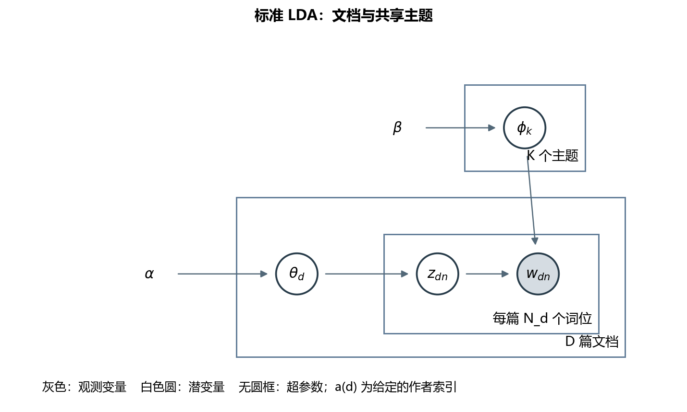

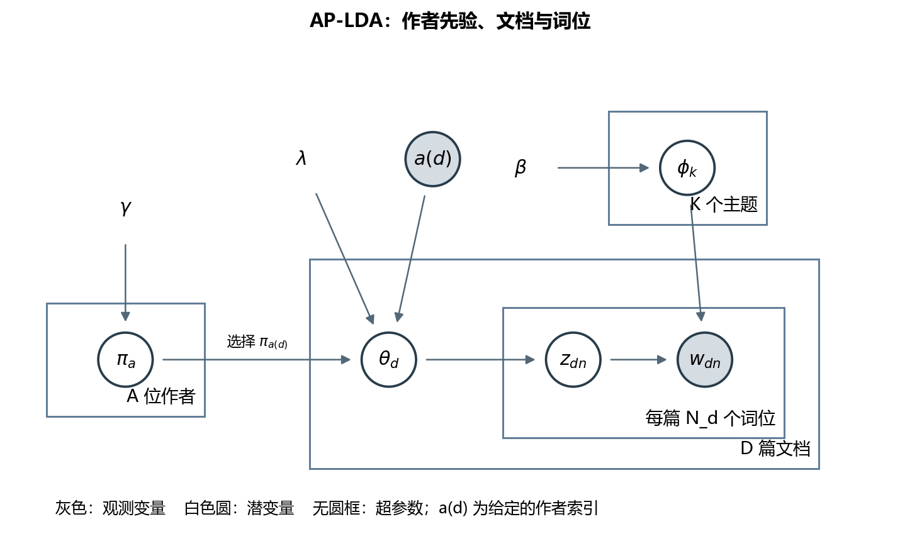

灰色 w 与 a(d) 是观测量；π 属作者 plate，θ 属文档 plate，z/w 属词位 plate；φ 是所有文档共享的主题词分布，置于独立主题 plate。a(d) 是已知索引，其箭头表达选择哪位作者的 π。本机未提供 Graphviz 可执行程序时，保存 DOT 源码并使用 Matplotlib 生成 PNG/SVG，实际后端见 rendering.json。

## 4. 生成过程

1. 为每个主题采样共享词分布 φ_k。
2. 为每位作者采样偏好 π_a。
3. 每篇文档根据给定作者 a(d) 从 Dir(λπ_a(d)) 采样 θ_d。
4. 逐词从 θ_d 采样主题 z_dn。
5. 从主题对应的 φ_k 采样词 w_dn。

以上也是合成验证语料的生成方式。真实新闻语料来自外部数据集，不由模型生成。

## 5. 参数推断

积分掉 Θ 与 Φ 后，词主题条件概率为

\[
p(z_{dn}=k\mid\cdot)\propto(n_{dk}^{-dn}+\lambda\pi_{a(d)k})
\frac{n_{k,w_{dn}}^{-dn}+\beta}{n_{k\cdot}^{-dn}+V\beta}.
\]

原始 π 后验包含 Γ(n_dk+λπ_ak)/Γ(λπ_ak)，不能直接认为是 Dirichlet。使用升阶乘的 Stirling 展开，引入 t_dk ~ CRT(n_dk,λπ_ak)，然后在扩充空间得到

\[
\pi_a\mid T,Z\sim\operatorname{Dir}\left(\gamma\mathbf1+\sum_{d:a(d)=a}t_d\right).
\]

每轮先边缘更新 Z，再采 T，再采 π，并丢弃旧 T；该顺序给出保持目标后验的不变转移核。基础依据为 [CRT 数据扩充](https://papers.nips.cc/paper_files/paper/2012/hash/6a61d423d02a1c56250dc23ae7ff12f3-Abstract.html)，本模型的具体推导在数学文档中独立写出。保存留样时的条件后验均值，再作样本平均，减少估计方差。Numba 仅加速逐词循环，没有替代推断逻辑。

### 数值诊断与合成恢复

测试包括 CRT 期望、非共轭 π 后验与数值积分对照、折叠密度差与 Z 条件概率的一致性、枚举极小语料后验并与链上作者熵比较、Dirichlet 理论矩、复现性、参数边界、概率归一化和保存加载。详见 `tests/` 与 `results/logs/tests.txt`。

下面的恢复实验仅使用明确的**合成语料**：固定语料种子 123，6 作者 × 24 文档 × 90 词位，K=3，λ=12，γ=0.5，β=0.05。分别用三个推断种子训练；使用 φ 的 Hungarian 匹配对齐标签，再测量 π 误差。不能直接按未对齐的主题编号计算恢复率。

| 条件 | 作者偏好 MAE ↓ | 主导主题准确率 ↑ | 主题词 MAE ↓ |
| --- | --- | --- | --- |
| 真实合成作者标签 | 0.0099 ± 0.0032 | 1.000 ± 0.000 | 0.0013 ± 0.0001 |
| 置换合成作者标签 | 0.2392 ± 0.0195 | 0.722 ± 0.096 | 0.0025 ± 0.0001 |

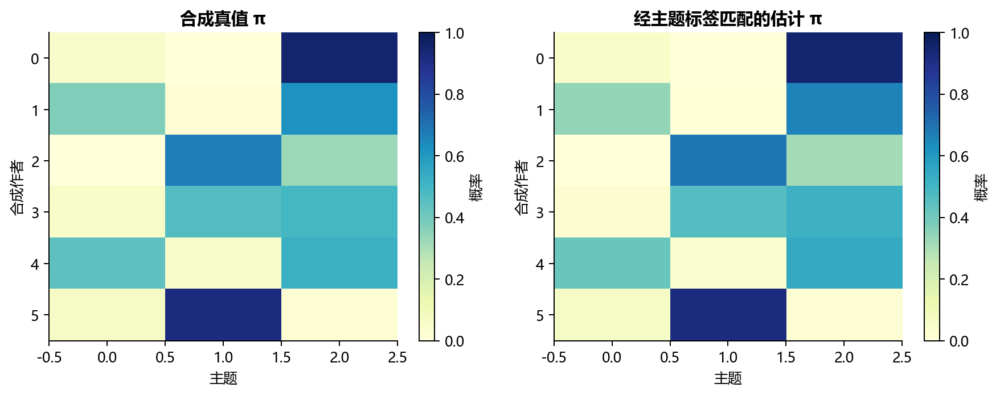

真实实验的三条匹配 AP 链，作者熵 split R-hat=3.921；熵 ESS 分别为 3.3, 3.6, 3.1。R-hat 偏离 1 或 ESS 较低提示链长与模式探索不足；即使某个标量表现良好，也不能保证主题矩阵充分混合。因此把本结果定位为有限预算的实证研究，而非已精确收敛的后验结论。

另实际运行三条 2400 轮的长链（burn-in=1200、thin=40），仅用验证集做预算敏感性检查，不修改主表的预声明结果。其作者熵 split R-hat=1.823。长链记录在 `long_chain_diagnostics.json`，仍不能替代全参数混合诊断。

| 种子 | 轮次 | burn-in | 熵 ESS | 验证集每词 log 概率 |
| --- | --- | --- | --- | --- |
| 11 | 2400 | 1200 | 18.2 | -6.6012 |
| 29 | 2400 | 1200 | 84.3 | -6.5913 |
| 47 | 2400 | 1200 | 9.8 | -6.5783 |

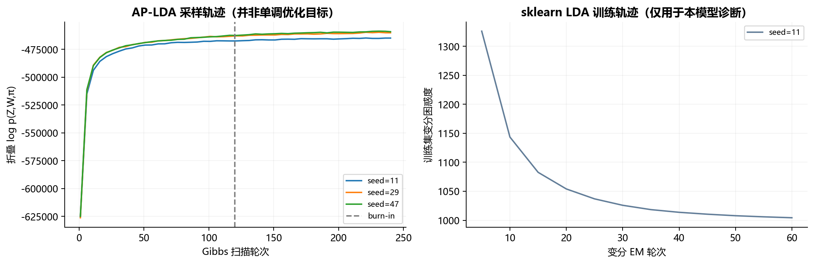

左图是采样状态的联合 log 密度，允许波动且不是 ELBO；右图是 sklearn 的训练变分困惑度。它们仅作各自诊断，数值不能跨模型比较。

## 6. 实验设置

### 数据与预处理

采用 [UCI Reuter_50_50](https://archive.ics.uci.edu/dataset/217/reuter+50+50)，DOI [10.24432/C5DS42](https://doi.org/10.24432/C5DS42)，UCI 页面标示 CC BY 4.0。压缩包实含 5000 篇文档、50 位记者，官方训练/测试各 2500 篇。该语料集中于 CCAT 企业/工业新闻，原本用于作者识别，限制了向跨领域语料外推的能力。

以固定种子 20261026 随机抽取 12 位记者。沿用官方训练/测试边界，从官方训练部分再取独立验证集。采用文件夹提供的单作者标签；不推断合著者或虚构作者身份。

| 划分 | 文档数 | 每位作者文档数 | 词位（截取后） | OOV 比率 |
| --- | --- | --- | --- | --- |
| train | 384 | 32 | 65302 | 26.58% |
| validation | 144 | 12 | 24267 | 28.68% |
| test | 240 | 20 | 38480 | 32.18% |

训练词汇 1800 项。清洗包括小写化、英文词切分、停用词、记者姓名/来源词去除、min_df=3、max_df=0.65。每篇最多均匀抽取 220 个词位，保留词重复计数；各模型共享同一个预处理文件。训练语料之外的文本不参与词表学习。OOV 不纳入评分，因此预测结论只针对词表内词，不能当作全词汇语言模型性能。

选中作者原始候选中删除 5 个规范化文本完全重复项。测试—训练 TF-IDF 最大余弦相似度的中位数/90%/99%/最大值为 0.454, 0.670, 0.886, 0.916；超过 0.95 的测试文档数为 0。这只是近重复审计，不能排除相关新闻在不同时间版本间的语义相似性。下载来源、SHA256、文档 ID、作者和划分清单均已保存。

### 模型与预算

- **LDA-sklearn**：成熟实现的 batch 变分 LDA，60 轮；β 一致，α=λ/K 匹配总浓度。
- **LDA-Gibbs**：本项目相同折叠词主题采样器，固定对称先验，用于控制推断算法差异。
- **AP-LDA**：真实作者标签，π 由 CRT 更新。
- **AP-shuffled**：置换文档作者标签，保持每个划分内的作者频数。训练、验证、测试独立置换，避免由训练标签恢复真实记者身份。

后三者训练 240 轮，burn-in=120，thin=6，每链留样 20 次；γ=0.5，β=0.01。随机种子 [11, 29, 47]。每个 Gibbs 配置迭代数相同；sklearn 迭代单位不同，另行报告运行秒数，不能声称同一计算预算。BLAS 设为单线程。sklearn 1.5 对 α 的元数据校验限制为 ≤1；为运行 λ/K>1 的合法 Dirichlet 先验，局部使用其公开 config_context(skip_parameter_validation=True)，模型自己的正值检查仍有效，原有变分更新未改写。

固定 K=10 扫描 λ=[1, 5, 10, 20, 50, 100]，然后每个模型在其验证集所选 λ 下扫描 K=[5, 10, 15, 20, 30]；这是顺序搜索，不是完整 K×λ 网格。比较稀疏性时固定 K=10、λ=10.0，每作者取 [4, 12, 32] 篇训练文档，保持原始训练词汇表和验证集不变。完整真实语料配置共 144 次训练。没有在测试集上挑选超参数，也不把测试集加入最终重新训练。

### 统一评估协议

每篇验证或测试文档按固定随机词位划分为观察词 O、预测词 H。所有模型使用同一个局部 Gibbs 核，固定已训练的 φ 和已知作者 π 后验均值，仅在 O 上估计 θ；局部采样 100 轮，后半程平均。对 H 计算 Σ log(θφ)，按词位总数归一化，再取指数获得困惑度。这是全局参数 **plug-in 单词边缘分数**，不是完整贝叶斯联合证据；不将任何训练 ELBO/困惑度用作跨模型预测指标。

未知作者或缺失作者标识时，局部从 Dir(γ1) 初始化 π，结合该篇 O 的 CRT 桌数进行推断。不会将未知作者简单替换成 Dir(λ/K) 而声称与层次先验严格相同；不同测试文档的未知作者不共享推断信息。空文档返回对称期望。

C_NPMI 用完整训练文档作为共现窗口，零共现词对记 −1；它与滑动窗口 NPMI 或 C_v 不相同。Top-10 词的并集比例用于主题多样性。报告均值±样本标准差（ddof=1），误差棒反映三个初始化种子的变异，不能解释为跨数据集置信区间。

## 7. 实验结果

### 7.1 预先固定 K、λ 的主对照（观察 50% 词位）

| 模型 | K | λ | 每词 log 概率 ↑ | 完成困惑度 ↓ | C_NPMI ↑ | 多样性 ↑ | 训练秒数 |
| --- | --- | --- | --- | --- | --- | --- | --- |
| LDA-sklearn | 10 | 10 | -6.7353 ± 0.0152 | 841.67 ± 12.80 | 0.1926 ± 0.0303 | 0.8433 ± 0.0153 | 9.67 ± 0.21 |
| LDA-Gibbs | 10 | 10 | -6.7290 ± 0.0080 | 836.34 ± 6.69 | 0.2091 ± 0.0470 | 0.8633 ± 0.0153 | 1.14 ± 0.08 |
| AP-LDA | 10 | 10 | -6.6969 ± 0.0366 | 810.29 ± 29.91 | 0.2027 ± 0.0968 | 0.8867 ± 0.0208 | 1.22 ± 0.05 |
| AP-shuffled | 10 | 10 | -6.7068 ± 0.0133 | 818.02 ± 10.92 | 0.2194 ± 0.0181 | 0.8867 ± 0.0115 | 1.22 ± 0.01 |

AP-LDA 的每词 log 概率比 LDA-Gibbs 更高，差值 +0.0321；对应平均 log 分数下的相对困惑度降低 +3.16%。相对 sklearn 的差值 +0.0384，相对作者置换对照的差值 +0.0099。这些是实际测量值；主题一致性、主题多样性和预测表现应分别判断，不能因某个指标提高而宣称所有指标都改善。

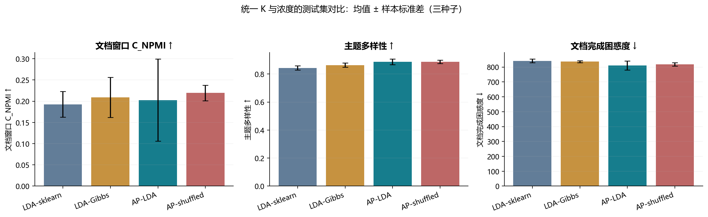

### 7.2 验证集分别选择超参数后的测试结果

选择信息在任何测试评分前写入 `results/metrics/selection.json`。每个模型使用同一候选范围与同样的三种子平均选择准则；不同模型的 K 和 λ 可以不同，因此本表用于比较各自配置的预测，而固定配置表更适合分析作者因素。

| 模型 | K | λ | 每词 log 概率 ↑ | 完成困惑度 ↓ | C_NPMI ↑ | 多样性 ↑ | 训练秒数 |
| --- | --- | --- | --- | --- | --- | --- | --- |
| LDA-sklearn | 30 | 5 | -6.6201 ± 0.0027 | 749.99 ± 2.06 | 0.1677 ± 0.0218 | 0.7144 ± 0.0051 | 11.35 ± 0.16 |
| LDA-Gibbs | 30 | 1 | -6.6197 ± 0.0024 | 749.69 ± 1.82 | 0.1890 ± 0.0115 | 0.7522 ± 0.0069 | 1.76 ± 0.11 |
| AP-LDA | 30 | 20 | -6.5640 ± 0.0055 | 709.12 ± 3.86 | 0.1971 ± 0.0180 | 0.7911 ± 0.0117 | 2.06 ± 0.08 |
| AP-shuffled | 30 | 1 | -6.5998 ± 0.0069 | 734.98 ± 5.05 | 0.2415 ± 0.0142 | 0.7467 ± 0.0088 | 1.92 ± 0.03 |

### 7.3 只观察 10% 词位的固定配置对照

| 模型 | K | λ | 每词 log 概率 ↑ | 完成困惑度 ↓ | C_NPMI ↑ | 多样性 ↑ | 训练秒数 |
| --- | --- | --- | --- | --- | --- | --- | --- |
| LDA-sklearn | 10 | 10 | -6.8136 ± 0.0106 | 910.18 ± 9.63 | 0.1926 ± 0.0303 | 0.8433 ± 0.0153 | 9.67 ± 0.21 |
| LDA-Gibbs | 10 | 10 | -6.8065 ± 0.0117 | 903.77 ± 10.57 | 0.2091 ± 0.0470 | 0.8633 ± 0.0153 | 1.14 ± 0.08 |
| AP-LDA | 10 | 10 | -6.7329 ± 0.0439 | 840.08 ± 37.21 | 0.2027 ± 0.0968 | 0.8867 ± 0.0208 | 1.22 ± 0.05 |
| AP-shuffled | 10 | 10 | -6.7817 ± 0.0137 | 881.59 ± 12.12 | 0.2194 ± 0.0181 | 0.8867 ± 0.0115 | 1.22 ± 0.01 |

词更少时先验占比更大，但是否受益仍由上表决定，不能预设 AP-LDA 必然改善。

### 7.4 探索性的作者簇不确定性

先在每篇文档内平均三个种子的 log 分数，再以作者为簇重采样 3000 次，保持每篇文档的词数权重。该区间描述本次 12 位作者样本内的变异；作者并非所有领域作者的随机代表，未做多重比较校正。

| 观察比例 | 对照 | AP−对照（每词 log 概率） | 作者簇 bootstrap 95% 区间 |
| --- | --- | --- | --- |
| 10% | LDA-Gibbs | +0.0737 | [+0.0473, +0.0993] |
| 10% | LDA-sklearn | +0.0808 | [+0.0541, +0.1088] |
| 10% | AP-shuffled | +0.0488 | [+0.0197, +0.0776] |
| 50% | LDA-Gibbs | +0.0321 | [+0.0113, +0.0535] |
| 50% | LDA-sklearn | +0.0384 | [+0.0196, +0.0578] |
| 50% | AP-shuffled | +0.0099 | [-0.0187, +0.0366] |

在观察 50% 词位时，真实标签相对置换标签的区间跨越 0，无法据此确认真实作者信息有稳定增益；只观察 10% 词位时，该探索性区间位于 0 以上，提示更短观察文本可能更依赖有信息的作者先验。两者都受有限作者样本、多重比较和链混合不足的限制。

### 7.5 λ 与主题数量敏感性（验证集）

| λ | LDA-sklearn | LDA-Gibbs | AP-LDA | AP-shuffled |
| --- | --- | --- | --- | --- |
| 1 | -6.6610 ± 0.0301 | -6.6456 ± 0.0197 | -6.6364 ± 0.0010 | -6.6367 ± 0.0080 |
| 5 | -6.6543 ± 0.0226 | -6.6602 ± 0.0074 | -6.6408 ± 0.0063 | -6.6504 ± 0.0309 |
| 10 | -6.6665 ± 0.0151 | -6.6734 ± 0.0152 | -6.6393 ± 0.0471 | -6.6474 ± 0.0162 |
| 20 | -6.6829 ± 0.0164 | -6.6920 ± 0.0088 | -6.6304 ± 0.0124 | -6.6797 ± 0.0061 |
| 50 | -6.7320 ± 0.0145 | -6.7568 ± 0.0026 | -6.6490 ± 0.0101 | -6.7401 ± 0.0057 |
| 100 | -6.8042 ± 0.0111 | -6.8246 ± 0.0133 | -6.6663 ± 0.0144 | -6.8226 ± 0.0182 |

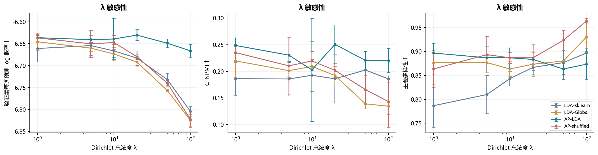

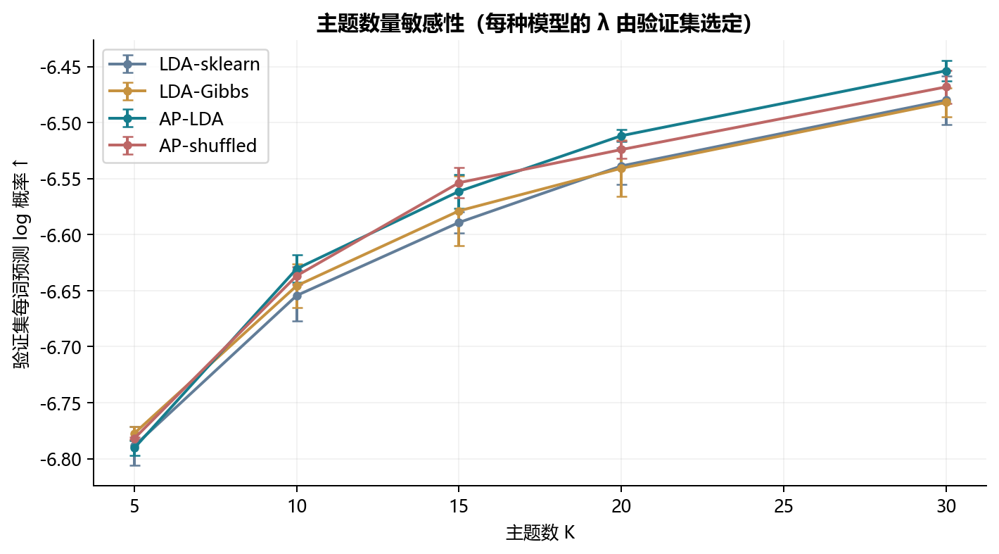

大 λ 可能强迫文档紧贴作者，遇到作者跨主题报道时产生偏差；小 λ 允许文档变化，但共享效应较弱。K 增加既改变模型容量，也改变 Kγ 的总浓度，此实验固定每维 γ 而非固定 Kγ，因此不能把 K 的影响完全归因于主题数量。

### 7.6 每位作者训练文档数

| 每作者训练文档数 | LDA-sklearn | LDA-Gibbs | AP-LDA | AP-shuffled |
| --- | --- | --- | --- | --- |
| 4 | -7.1488 ± 0.0033 | -7.1236 ± 0.0068 | -7.1364 ± 0.0060 | -7.1353 ± 0.0154 |
| 12 | -6.8740 ± 0.0160 | -6.8686 ± 0.0202 | -6.8442 ± 0.0087 | -6.8646 ± 0.0094 |
| 32 | -6.6665 ± 0.0151 | -6.6734 ± 0.0152 | -6.6393 ± 0.0471 | -6.6474 ± 0.0162 |

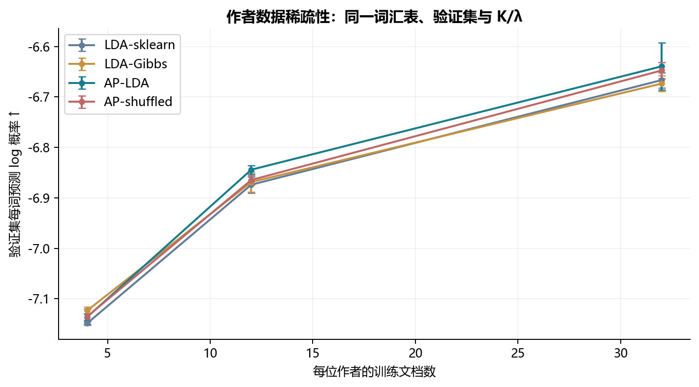

这是重新训练整个模型的验证集实验，主题词分布也随文档数改变；不能把曲线全部解释成仅 π 的估计误差。共同词表由最大训练子集生成，用于保持表示一致，不代表最严格的“只有四篇文档可获取”的完整数据场景。

### 7.7 作者偏好与文档案例

展示模型固定为预先声明的 K=10、λ=10.0、第一个种子 11，没有按测试表现或图形好看程度挑选链。主题编号仅在该模型内有意义。

| 作者 | 偏好前三主题及概率 | 最高主题的关键词 |
| --- | --- | --- |
| AaronPressman | T6: 0.551, T8: 0.170, T5: 0.082 | internet, companies, computer, banks, software, access |
| BernardHickey | T3: 0.251, T4: 0.207, T1: 0.198 | news, corp, australian, murdoch, sydney, media |
| JimGilchrist | T0: 0.308, T7: 0.192, T9: 0.124 | cargo, toronto, gold, stocks, canada, air |
| JoeOrtiz | T8: 0.289, T4: 0.245, T2: 0.113 | company, business, time, chairman, shareholders, amp |
| KeithWeir | T2: 0.339, T4: 0.170, T8: 0.162 | million, pounds, television, british, microsoft, united |
| KevinMorrison | T4: 0.266, T3: 0.196, T8: 0.156 | percent, bank, market, billion, stock, share |

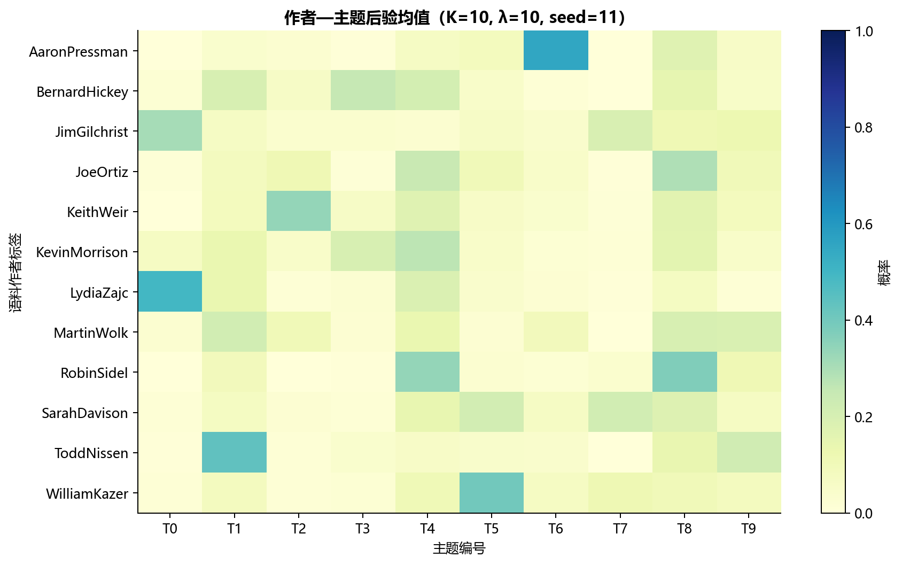

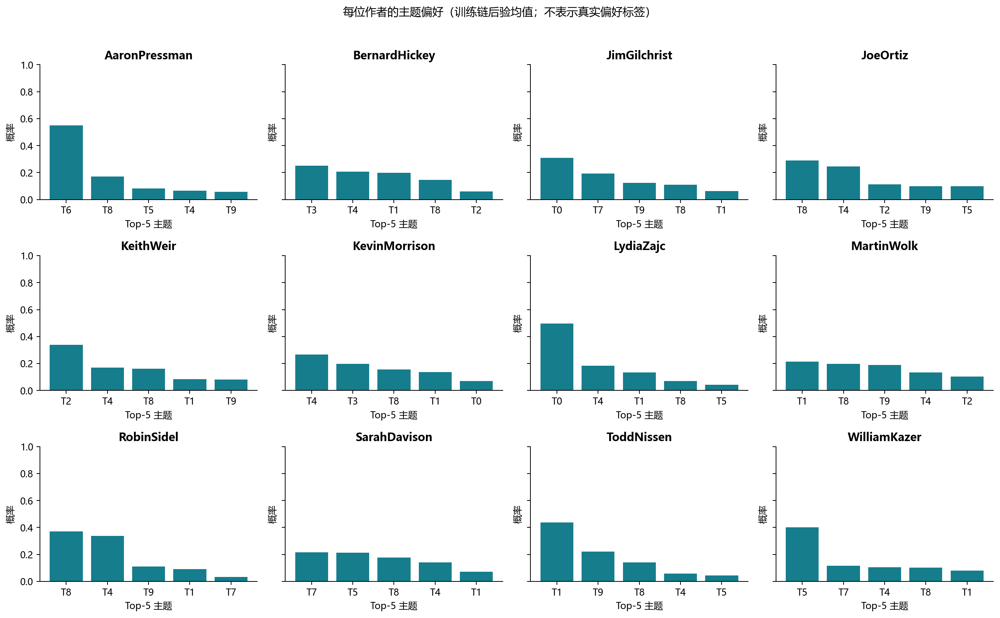

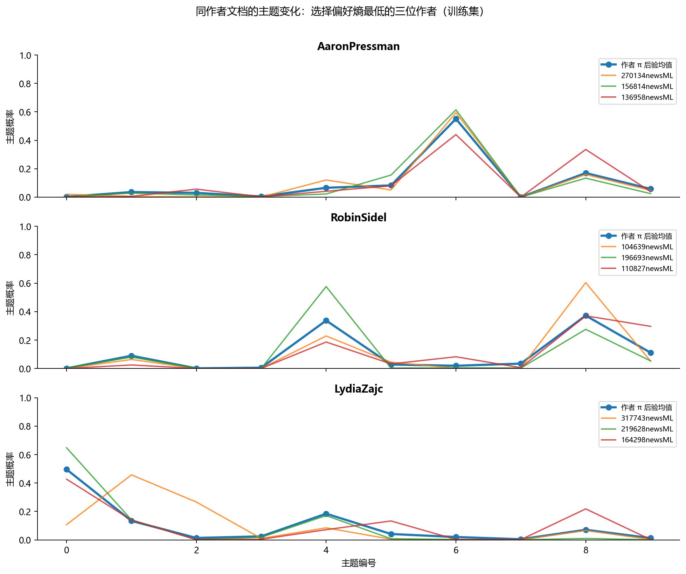

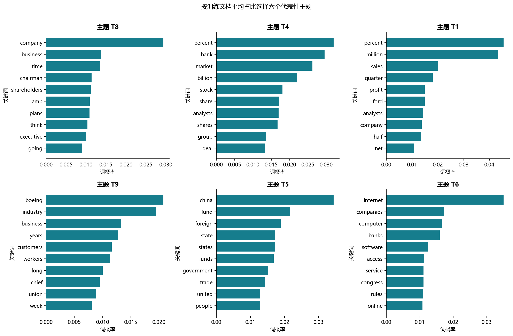

同一作者不同 θ 可以偏离 π；共享先验不等于把作者所有文档合并。关键词显示记者报道领域差异，但没有真实人工主题/偏好标签，无法用这些图证明真实作者偏好识别准确率。真实语料的作者图属于定性解释；只有合成恢复实验具有已知 π 真值。

## 8. 模型优势

作者层将多篇文档的信息汇集为可解释的概率分布，同时保留文档变化。数据充足且作者报道主题稳定时，这种共享可以提供有用先验，特别是观察文本短的场景。相同 Gibbs 对照与作者置换对照分别控制采样算法和标签有效性，减少把训练算法或参数量差异误认成作者效应的风险。CRT 核无需梯度和非共轭近似优化，数学上保持给定有限主题模型。

## 9. 局限性与未覆盖部分

本研究是 12 作者、企业新闻领域的小规模实验；只检验一个真实语料，不覆盖大规模学术摘要、多语种、多作者归属、兴趣随时间变化或未见作者群体的独立测试集。只有单篇未知作者的接口与数值测试，没有独立未知作者基准。32 篇训练文档/作者相对有限；数据存在年代、领域、记者选择和相关新闻版本偏差。

240 轮主实验链的混合可能不足，尤其不同初始主题可能落在不同模式；标量熵 R-hat/ESS 不能检验全部参数，不同链不进行按主题编号直接平均。预测使用后验均值的 plug-in 近似，未积分全部全局不确定性。真实 π 无真值，不能报告恢复误差。γ、β 和预处理阈值固定，没有扫描全部超参数。顺序超参数搜索也未穷举联合网格。

没有完成：全量 50 作者/5000 文档实验、跨数据集复核、完整 K×λ 网格、大规模长链的全参数诊断、时间漂移与多作者扩展、C_v 和人工主题质量评审。这些不影响当前实现与已完成实验的复现，但限制结论强度。

## 10. 总结

在本次预先固定配置、50% 文档完成条件下，AP-LDA 相对相同采样器 LDA 的每词预测分数变化为 +0.0321，相对置换标签对照为 +0.0099。引入作者先验是否改善 LDA，应同时参考固定配置、验证选择后的结果、三种子波动以及作者簇区间；不能从单条链或合成恢复直接推论真实语料总体优势。

更具体地，观察 50% 词位时，AP 相对作者置换的作者簇区间为 [-0.0187, +0.0366]，跨越 0；观察 10% 时增益 +0.0488，区间为 [+0.0197, +0.0776]。因此短观察文本显示更明确的探索性作者信息收益，半篇观察条件下尚不足以断言真实标签优于无信息标签。主链 R-hat=3.921、补充长链 R-hat=1.823，仍需改善混合后复核结论。

当作者偏好稳定、历史文档充分、观察文本短且共享强度适当时，作者信息可能有效；作者标签缺乏信息、训练数据稀疏、兴趣变化明显或 λ 过大时，可能无效甚至有害。当前证据仅适用于已记录的语料、划分和有限预算，需更多语料与更长链确认外推结论。

## 复现与产物

- 入门与逐步讲解：[演示.ipynb](../演示.ipynb)。
- 一键运行：`python -m scripts.run_experiments --config configs/default.yaml`；使用相同配置时自动读取已有配置结果，`--no-resume` 可重训。
- 测试：`python -m pytest -q`。
- 数学推导：[mathematical_model.md](mathematical_model.md)。
- 原始指标：`results/metrics/validation_runs.csv`、`test_scores.csv`、`test_document_scores.csv`、`runs/*.json`。
- 配置/环境/日志：`results/config_snapshot.yaml`、`environment.json`、`logs/run.log`、`logs/tests.txt`。
- 全量作者/文档/主题词分布：`results/distributions/`；模型存于 `results/checkpoints/`。
- 数据来源与哈希：`data/raw/provenance.json`；数据审计与划分：`data/processed/audit.json`、`*_documents.json`。
